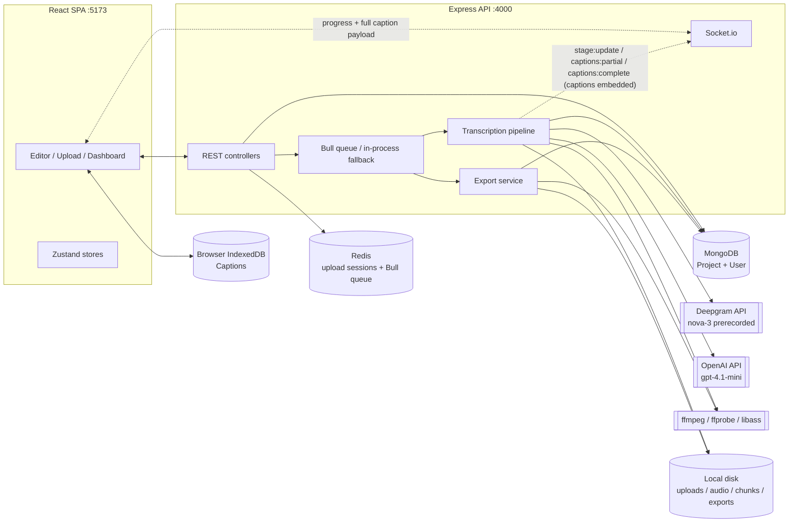
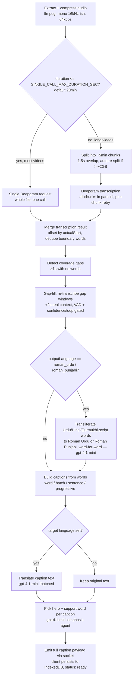

# Asaan Caption — Architecture & Pipeline

Asaan Caption is a MERN-stack video captioning platform: upload a video, get AI-transcribed,
translatable, stylable captions with a live preview editor, and export a burned-in video or
SRT/JSON. This document explains how the whole system fits together and why the transcription
pipeline is built the way it is.

## Contents

- [Tech stack](#tech-stack)
- [Repo layout](#repo-layout)
- [System architecture](#system-architecture)
- [Data model](#data-model)
- [Auth](#auth)
- [Video upload](#video-upload)
- [Transcription pipeline](#transcription-pipeline)
- [Real-time progress](#real-time-progress)
- [Job queue](#job-queue)
- [Editor & caption display templates](#editor--caption-display-templates)
- [Export (burned-in video / SRT / JSON)](#export-burned-in-video--srt--json)
- [Cleanup](#cleanup)
- [Configuration reference](#configuration-reference)
- [Tuned heuristics — what they are and why](#tuned-heuristics--what-they-are-and-why)
- [Dev workflow](#dev-workflow)

## Tech stack

| Layer | Technology |
| --- | --- |
| Client framework | React 19 + TypeScript, Vite 8 |
| Client routing / state | react-router-dom 7, Zustand 5 (stores, no Redux) |
| Client UI | Tailwind CSS 4, Framer Motion (animation), lucide-react (icons), react-colorful, react-dropzone |
| Client data | axios (REST + interceptor-based token refresh), socket.io-client (live progress) |
| Server framework | Express 5 (via `express` 4.x API surface) on Node.js 20+, TypeScript, `tsx` for dev/watch |
| Server auth | JWT (access + refresh), `jsonwebtoken`, `bcryptjs`, httpOnly refresh cookie |
| Database | MongoDB via Mongoose 8 (falls back to an ephemeral in-memory Mongo via `mongodb-memory-server` when `MONGODB_URI=memory`) |
| Cache / session store | Redis via `ioredis` (falls back to an in-process memory shim, `db/memoryRedis.ts`, when `REDIS_URL=memory`) |
| Job queue | Bull (Redis-backed); falls back to direct in-process `setImmediate` execution when Redis is in memory mode |
| Real-time | Socket.io (project-scoped rooms, JWT-authenticated handshake) |
| Media processing | `fluent-ffmpeg` + `@ffmpeg-installer/ffmpeg` + `@ffprobe-installer/ffprobe` (bundled binaries, no system install needed) |
| Speech-to-text | Deepgram prerecorded API (`nova-3`, word timestamps) via plain `fetch` — no SDK. (A dead OpenAI Whisper code path is kept block-commented alongside it for rollback; see [Transcription pipeline](#transcription-pipeline).) |
| Script conversion / translation / emphasis | OpenAI `gpt-4.1-mini` (Chat Completions, strict JSON schema outputs) |
| Subtitle burn-in | Self-authored `.ass` (Advanced SubStation Alpha) generation + `libass` via ffmpeg's `ass` filter |
| Validation | Zod (both request-body schemas and a few client-side shapes) |
| Containers | Docker Compose (MongoDB 7 + Redis 7 for local/prod-like dev) |

## Repo layout

```
CaptionFlow/
├─ client/                  React SPA
│  └─ src/
│     ├─ pages/             LoginPage, RegisterPage, DashboardPage, UploadPage, EditorPage
│     ├─ components/        AppShell, CaptionOverlay, PrepareMediaModal
│     ├─ stores/             authStore, captionStore, editorChromeStore (Zustand)
│     └─ lib/                api.ts, socket.ts, uploader.ts, captionPosition.ts, displayCaptions.ts, captionTemplates.ts
├─ server/                  Express API + background pipeline
│  └─ src/
│     ├─ controllers/        auth, upload, project
│     ├─ routes/              auth, upload, project (+export), health
│     ├─ middleware/          auth (JWT), errorHandler, requestId, timeout, validate
│     ├─ models/               User, Project (Mongoose) — captions live client-side in IndexedDB, not Mongo
│     ├─ services/             ffmpeg, vad, whisper, translation, captionGrouper, emphasis, pipeline, export, cleanup
│     ├─ queues/                Bull queue definitions + in-process fallback
│     ├─ workers/               registers Bull processors (or interval-based fallback)
│     └─ db/                    mongo.ts, redis.ts, memoryRedis.ts
├─ segmentation/            optional Python person-matte service (text behind person)
└─ docker-compose.yml        MongoDB + Redis for local dev
```

## System architecture



Captions are never written to Mongo. The pipeline builds them in memory, assigns each a
client-generated-style `id` (`crypto.randomUUID()`), and delivers the full set to the browser as
the payload of the `captions:complete` socket event; the client persists them into its own
IndexedDB and reads/writes them locally from then on (edits never round-trip to the server).
Export requires the client to send its current IndexedDB-sourced caption array with every export
request — there is no server-side fallback to read captions from.

## Data model

Two Mongoose collections ([`server/src/models`](server/src/models)):

- **`User`** — email/password (bcrypt hash), plan (`free`/`pro`), a rolling list of up to 5
  hashed refresh tokens (multi-device sessions, oldest evicted).
- **`Project`** — one per uploaded video. Tracks upload state, video metadata, the full audio
  processing/chunk table, the raw merged transcript (`transcription.words`/`segments`), user
  settings (caption mode, output language, Whisper options), the style object the editor/export
  both read, export job state, and a `stage` field (`current`/`percent`/`message`) mirrored to the
  client over Socket.io.

Captions are **not** a Mongo collection — they live entirely in the browser's IndexedDB
([`client/src/lib/captionDb.ts`](client/src/lib/captionDb.ts)), one record per on-screen caption
phrase, keyed by a `crypto.randomUUID()` id assigned server-side at generation time. Each holds
`text` (display, possibly translated), `originalText`, per-word timings (`words`), and two
parallel per-word arrays aligned to `text.split(/\s+/)`: `emphasis` (`hero`/`small`/`normal`/`auto`
— which word is visually emphasized) and `wordStyles` (manual per-word size/color overrides). This
is a deliberate tradeoff: captions never sync across devices/browsers and are permanently lost if
local storage is cleared before they're received — accepted in exchange for zero server-side
caption storage. The "Regenerate Captions" flow (full re-transcription) is the recovery path if
local captions are ever missing.

## Auth

Standard JWT access + refresh flow ([`middleware/auth.ts`](server/src/middleware/auth.ts),
[`controllers/auth.controller.ts`](server/src/controllers/auth.controller.ts)):

- Access token: short-lived JWT (`JWT_ACCESS_EXPIRES`, default 15m), set as an `httpOnly` cookie —
  never exposed to JS (no `localStorage`/`Authorization`-header usage on the client).
- Refresh token: random 48-byte token (not a JWT), stored **hashed** (SHA-256) on the `User` doc,
  set as its own `httpOnly` cookie scoped to `/api/auth` (`sameSite: strict` in production).
- The client's axios instance ([`lib/api.ts`](client/src/lib/api.ts)) intercepts `401`s, calls
  `/auth/refresh` once (de-duped via a shared in-flight promise), and retries the original request.
- Socket.io connections authenticate the same access token during the handshake
  ([`socket.ts`](server/src/socket.ts)) and join a `user:<id>` room automatically.

## Video upload

Two paths, chosen client-side by file size ([`lib/uploader.ts`](client/src/lib/uploader.ts)):

- **< 100MB (`FAST_UPLOAD_THRESHOLD_BYTES`)** — single multipart POST to `/upload/single`
  (memory-buffered by multer, capped at that same threshold).
- **≥ 100MB** — chunked, resumable upload:
  1. `POST /upload/init` — creates a `Project` (`status: 'uploading'`) and an upload session in
     Redis (`upload:<id>:meta`, 48h TTL), returns `uploadId` + `chunkSize` (`CHUNK_SIZE_BYTES`,
     default 10MB).
  2. `POST /upload/chunk` per 10MB slice — written to disk, tracked in a Redis set
     (`upload:<id>:chunks`) so `GET /upload/status/:uploadId` can report which chunks are missing
     and the client can **resume** an interrupted upload by re-querying that endpoint and only
     sending what's missing.
  3. `POST /upload/complete` — verifies every chunk arrived, streams them into one file on disk in
     order, reads video metadata via ffprobe, and flips the `Project` to `status: 'uploaded'`.
- Hard cap: `MAX_VIDEO_SIZE_BYTES` = 1GB, enforced both client- and server-side.
- `GET /projects/:id/video` streams the assembled file back with HTTP range support (video
  scrubbing in the editor), authenticating via the `cf_access` httpOnly cookie — it rides along
  automatically on the `<video src>` request, so no token needs to be attached by hand.

## Transcription pipeline

The core of the app. Runs either as a Bull job or, in local/dev mode (`REDIS_URL=memory`), directly
in-process via `setImmediate` — same function either way:
[`runTranscriptionPipeline`](server/src/services/pipeline.service.ts).



> **Note on the diagram above:** the bulk per-chunk VAD stage that used to sit between splitting and
> transcription is commented out (not deleted) in `pipeline.service.ts` — see Stage 2 below and
> ["Single call vs. chunked" fork](#single-call-vs-chunked-fork-and-the-removed-bulk-vad-stage).

### Stage 1 — Extract & compress audio

[`ffmpeg.service.ts: extractAndCompressAudio`](server/src/services/ffmpeg.service.ts) pulls the
audio track out of the uploaded video and compresses it (`AUDIO_BITRATE`, default 64kbps) — smaller
files transcribe faster and cost less to send to Deepgram.

### Stage 2 — Split into chunks, or a single request

[`runTranscriptionPipeline`](server/src/services/pipeline.service.ts) branches on the extracted
audio's duration:

- **`durationSeconds <= SINGLE_CALL_MAX_DURATION_SEC`** (default 1200s / 20min — covers the large
  majority of videos): the whole extracted audio file is sent to Deepgram in **one request**. No
  splitting, no VAD, no merge step beyond wrapping the single result in the same shape multi-chunk
  results use.
- **Longer videos**: [`splitAudioIntoChunks`](server/src/services/ffmpeg.service.ts) cuts the audio
  into `AUDIO_CHUNK_DURATION`-second windows (default **300s**) with `AUDIO_CHUNK_OVERLAP` (default
  1.5s) of extra audio at each boundary so a word spoken right at a cut isn't sliced in half — the
  merge step later re-derives which chunk each overlapping word "really" belongs to by its true
  offset. If a chunk still comes out bigger than `SAFE_CHUNK_MB` (default ~2GB, far above anything
  this app's audio produces), it's recursively re-split at half the duration.

#### Single call vs. chunked fork, and the removed bulk VAD stage

Chunking exists for parallelism, not Deepgram's file-size limit: Deepgram's prerecorded endpoint
accepts up to ~2GB per request, and this app's compressed audio never gets remotely close. With N
chunks firing at Deepgram concurrently, wall-clock time is bounded by *one chunk's* duration, not
the whole video — which is what makes the chunked path worth keeping for long videos, and why
collapsing everything to one call unconditionally would make long videos *slower*, not faster.
Deepgram's prerecorded endpoint also has a soft server-side processing-time budget (roughly 10
minutes wall-clock under load, reported as an occasional 504) that a single very long request risks
more than several smaller ones — `SINGLE_CALL_MAX_DURATION_SEC` is set well under that with margin.

The old **bulk per-chunk VAD stage** — [`vad.service.ts`](server/src/services/vad.service.ts)
classifying every split chunk as `speech`/`uncertain`/`silence` (RMS energy over 30ms windows +
ffmpeg's `silencedetect` filter) and skipping Deepgram calls on silent ones — is commented out in
`pipeline.service.ts` (search "LEGACY: bulk per-chunk VAD"), not deleted. It wasn't a Deepgram
feature (Deepgram's own VAD/endpointing only applies to its live-streaming API, which this app
doesn't use) and Deepgram's `nova-3` doesn't hallucinate on silence the way the old Whisper path
did, so the only thing it bought was skipping Deepgram's per-minute cost on genuinely silent
chunks — at the cost of 2 extra ffmpeg spawns per chunk, serially, before transcription could even
start. `vad.service.ts` itself is still live: [`fillCoverageGaps`](server/src/services/pipeline.service.ts)
(Stage 6) still calls `classifyChunkVad` on individual gap windows, a much narrower and cheaper use
that only fires on actually-detected gaps.

**To revert:** set `SINGLE_CALL_MAX_DURATION_SEC=0` (always chunked) and uncomment the bulk-VAD
block in `pipeline.service.ts` — two independent, low-risk switches, no code deletion required
either way.

### Stage 3 — Deepgram transcription

[`whisper.service.ts: transcribeChunk`](server/src/services/whisper.service.ts) — despite the
filename, this now calls Deepgram's prerecorded `POST /v1/listen` (`model=nova-3`) via plain
`fetch`, not the OpenAI SDK; a dead OpenAI Whisper code path is kept block-commented in the same
file for rollback. Every chunk (or the single whole-file "chunk") is sent via `Promise.all` — fully
parallel, gated only by [`deepgramPool.service.ts`](server/src/services/deepgramPool.service.ts), a
hand-rolled multi-key concurrency pool with cooldown/failover on 401/402/429 responses
(`DEEPGRAM_CONCURRENCY_PER_KEY` in-flight calls per key).

- Whole-chunk failures get one retry with a 1.5s backoff; the pipeline still finishes with the
  remaining chunks if some ultimately fail (`status: 'partial_error'`), rather than failing the
  entire video.
- A chunk that comes back with zero words no longer implies failure — with the bulk VAD stage
  removed, a genuinely silent file/chunk reaching Deepgram and getting an empty transcript back is
  the *expected* outcome, and the pipeline treats an all-empty result (no failures) as a clean "no
  speech detected" ready state rather than an error.

`MAX_CONCURRENT_WHISPER` (env var) caps how many chunks the Bull worker processes in parallel
*across projects*, and separately bounds the chunk-splitting/extraction concurrency in the chunked
path — it has no effect on the single-call path, which is always exactly one request per project.

### Stage 4 — Merge

[`mergeChunkTranscriptions`](server/src/services/whisper.service.ts) offsets every chunk's word
timestamps by that chunk's true file start (`actualStart`, which includes the leading overlap —
**not** `nominalStart`), keeps only words that fall inside each chunk's own nominal window (so
overlap-region duplicates go to the correct neighbor), and de-duplicates near-identical
boundary-straddling words. The single-call path calls this too, with a one-element array spanning
the whole file (`nominalStart: 0` to the full duration) — it's a no-op merge that just normalizes
the result into the same shape the chunked path produces, so every stage after this one is
identical regardless of which path ran.

### Stage 5 — Gap-fill

[`findCoverageGaps`](server/src/services/whisper.service.ts) scans the merged word timeline for
holes ≥1s with no words — evidence that Deepgram (or, on the chunked path, a chunk boundary) missed
real speech. For each gap, [`fillCoverageGaps`](server/src/services/pipeline.service.ts) re-extracts
that window **with 2 extra seconds of real audio context on each side** (so the model has something
to anchor on instead of guessing blind on an isolated island), runs it past `classifyChunkVad` to
skip windows that are genuinely silent, and re-transcribes the rest fresh. The result is only merged
in if it passes a **local confidence/loop gate** — otherwise it's discarded: a missing caption is
preferred over a confidently wrong one. This runs identically on both the single-call and chunked
paths — it isn't part of what the single-call path skips.

### Stage 6 — Roman Urdu / Roman Punjabi transliteration (optional, two-agent design)

When `settings.outputLanguage === 'roman_urdu'`,
[`translation.service.ts: transliterateWordsToRomanUrdu`](server/src/services/translation.service.ts)
converts every word written in Urdu/Arabic or Hindi/Devanagari script to Roman Urdu (Latin letters),
**one output word per input word**, preserving exact timestamps. English words already in Latin
script pass through completely unchanged — so a code-switched sentence like
*"میرا نام داؤد ہے and I am a student"* becomes *"mera naam Dawood hai and I am a student"* with the
speaker's exact code-switching intact.

`roman_punjabi` works the same way via `transliterateWordsToRomanPunjabi`, converting Gurmukhi-script
words to Roman Punjabi while leaving English words untouched — both share the same batching/retry
mechanics, differing only in script-detection regex and system prompt.

This is deliberately a **separate pass from transcription**, not a transcription-prompt trick:
earlier attempts (back on Whisper) asked the STT model to transcribe *and* transliterate in one
step, which biased the decoder and cost word-level accuracy. Transcription always happens in
whatever script the model hears natively (its most accurate mode); a dedicated `gpt-4.1-mini`
agent does script conversion afterward on the already-correct words.

### Stage 7 — Build captions

[`captionGrouper.ts: buildCaptions`](server/src/services/captionGrouper.ts) groups the flat word
stream into on-screen caption phrases. Four modes (`Project.settings.captionMode`):
- **`word`** — one word per caption.
- **`batch`** — fixed-size groups (3/5/7 words), breaking early on a real silence gap or sentence
  punctuation, with an "orphan merge" pass so a lone leftover word never flashes alone unless a real
  pause isolates it.
- **`sentence`** — same grouping logic with a larger word budget (up to 12).
- **`progressive`** (default) — CapCut-style build-up: *"Hi" → "Hi how" → "Hi how are" → "Hi how are
  you?"*, each step its own timed caption.

All modes share timing-normalization (`normalizeWordTimings`) that fixes inverted/zero-length/
overlapping transcription timestamps and clamps absurdly long single-word durations before grouping.

### Stage 8 — Translation (optional)

If a target language is set (anything other than `keep_original`, `roman_urdu`, or `roman_punjabi`,
which are handled above), [`translateAllCaptions`](server/src/services/translation.service.ts) translates each built
caption's text in batches via `gpt-4.1-mini` with a strict JSON-schema response, preserving caption
count and order.

### Stage 9 — Emphasis (hero + support word)

[`emphasis.service.ts: pickHeroWords`](server/src/services/emphasis.service.ts) runs for **every**
project regardless of chosen display template, so hero-word-style templates are always ready. A
`gpt-4.1-mini` agent labels exactly one `hero` word (most impactful) and one `small`/support word
per caption, explicitly avoiding filler/function words in English, Urdu, and Roman Urdu. A
deterministic local fallback (longest non-filler content word) covers model failures — always one
of each, never empty.

### Stage 10 — Persist

Each caption is assigned a `crypto.randomUUID()` id, the `Project` flips to `status: 'ready'` (or
`'partial_error'` if some chunks failed), and a `captions:complete` Socket.io event fires carrying
the full caption array as its payload — the client persists that into its own IndexedDB, which is
the only place captions are stored (see Data model above).

### Rebuild (no re-transcription)

`POST /projects/:id/rebuild` with `retranscribe: false` re-runs stages 6–10 only, from the
**already-stored** transcript words — e.g. switching caption mode from `batch` to `sentence`, or
changing the target language, costs zero Deepgram calls. `retranscribe: true` (the default) reruns
the entire pipeline from Stage 1.

## Real-time progress

[`socket.ts`](server/src/socket.ts): a JWT-authenticated Socket.io server. Every connected client
auto-joins `user:<id>`; the editor additionally joins `project:<id>` on open
(`project:join`/`project:leave`). The pipeline emits to that room throughout:

| Event | When |
| --- | --- |
| `stage:update` | Every stage transition and percent tick (`extracting` → `splitting` → `transcribing` → `merging` → `translating` → `ready`; `vad` only appears if the commented-out bulk VAD stage is restored) |
| `audio:extracting`, `splitting:done` | Fine-grained stage 1–2 progress |
| `transcription:chunkDone` / `chunkError` / `chunkSkipped` | Per-chunk Deepgram results (`chunkSkipped` only fires if the bulk VAD stage is restored) |
| `captions:partial` | Streamed caption groups as each chunk finishes — the editor shows captions appearing incrementally instead of waiting for the whole video. On the single-call path there's only one "chunk," so this fires once, right before `captions:complete` |
| `captions:complete` | Pipeline finished (or a silent-audio short-circuit) — payload carries the full caption array, which the client writes into IndexedDB (no separate REST fetch) |
| `translation:progress` | Batch-by-batch translation/transliteration/emphasis progress |
| `export:*` | Export job progress/cancellation |

## Job queue

[`queues/index.ts`](server/src/queues/index.ts) defines four Bull queues (`transcription`,
`export`, `cleanup`, `segment`) backed by Redis, with 3 retries and exponential backoff — except
`segment` (person mattes), which gets a single attempt because a re-run costs GPU minutes. When
`REDIS_URL=memory` (the default local-dev config), queues are **not created** — `enqueueX()` calls
instead run the same service function directly via `setImmediate`, so the whole pipeline works
without any Redis install. [`workers/register.ts`](server/src/workers/register.ts) wires the Bull
processors (`MAX_CONCURRENT_WHISPER` concurrent transcription jobs, 1 export at a time) or, in the
fallback case, just sets up the hourly cleanup interval.

## Editor & caption display templates

The editor ([`EditorPage.tsx`](client/src/pages/EditorPage.tsx)) shows the source video with a live
caption overlay ([`CaptionOverlay.tsx`](client/src/components/CaptionOverlay.tsx)) driven entirely
client-side: [`displayCaptions.ts`](client/src/lib/displayCaptions.ts) derives *display* captions
(word-by-word, karaoke, phrase, rolling, paint-on, typewriter, …) from the canonical stored
captions on every render — switching display mode is instant and free (no API call).

Style is one JSON blob (`Project.style`) covering font, color, position (drag-to-move, corner-drag
to resize, stored as % of canvas so preview and export always agree), animation, and **template** —
which controls per-word layout, not just typography:

`Project.style.template` is a 21-value enum (`styleSchema` in
[`project.controller.ts`](server/src/controllers/project.controller.ts)); the picker in
[`captionTemplates.ts`](client/src/lib/captionTemplates.ts) / `EditorPage.tsx`'s `UNIFIED_TEMPLATES`
surfaces 17 of them as cards — `mixed`/`mixed2` (Mixed Styles / Mixed Styles 2) are hidden from the
picker but kept fully wired (client render + server export) for restore:

| Template | Look |
| --- | --- |
| `classic` | Plain phrase/karaoke text |
| `hero` | Every word its own centered line; the emphasized word is bold/colored |
| `heroWord` (Hero Word) | Words build up inline one at a time; exactly one hero (bold, colored, uppercase) + one support (large italic) word, everything else small — the hero **and** the support word each force their own centered line break, before and after |
| `stack` (Poetic Stack) | Mixed-size stacked lines, cycling a 4-beat size pattern |
| `bigpop` | One giant uppercase word at a time |
| `highlight` (Marker Pen) | Phrase text with the key word underlined/marked — **never** consumes AI emphasis; the marked word is always the longest word in the caption |
| `mixed` / `mixed2` | Hidden-from-picker — a different curated look per sentence, cycling through 8 sub-styles each (`mixed2` is the calmer, more editorial successor) |
| `editorMasala` | Tiny lowercase lead-in pops into a giant yellow shout word |
| `aura` | Serif italic paired with an electric-blue uppercase accent |
| `swiss` | Heavy grotesk stack with a yellow punch on the key word |
| `theBigRed` | One monumental red serif word with a thin caption crossing it |
| `scribble` | Handwritten script with a highlighter mark behind one word |
| `archives` | Elegant script with one word underlined by hand |
| `animeEdit` | Per-letter kinetic canvas — five looks intercut per caption (scatter, neon, chaos, slam, glitch) |
| `blockbuster` | Per-letter kinetic canvas — red condensed heading with glow/shadow/tilt over a white script line |

Three independent burn-in renderers exist (see [Export](#export-burned-in-video--srt--json)):
`classic`/`bigpop`/`highlight`/`editorMasala`/`aura`/`swiss`/`theBigRed`/`archives`/`scribble` go
through a real-metrics canvas **PNG-overlay** path
([`captionPng.service.ts`](server/src/services/captionPng.service.ts)); `heroWord`/`hero`/`stack`/
`mixed`/`mixed2` go through **`.ass`/libass** burn-in; `animeEdit`/`blockbuster` stream **raw RGBA
frames** drawn by the one shared kinetic engine
([`client/src/lib/kinetic/engine.ts`](client/src/lib/kinetic/engine.ts), byte-identical copy in
`server/src/services/kinetic/engine.ts`) into ffmpeg's stdin
([`kineticPng.service.ts`](server/src/services/kineticPng.service.ts)) — see
[`client/src/components/KINETIC_TEMPLATES.md`](client/src/components/KINETIC_TEMPLATES.md). Getting a template's hero-word handling wrong
in the wrong renderer is a real failure mode — `classic`/`bigpop`/`highlight` are explicitly
*not* supposed to react to the AI-picked hero/support word (every caption gets one regardless of
template — see Stage 9 below), and both `CaptionOverlay.tsx`'s live preview and the ASS fallback in
`dialogueText()` enforce that; the PNG-overlay path once didn't (fixed 2026-09-03 — an unconditional
"manual role" branch in `resolveStyledWords()` was overriding those three templates on every
export, so the picked template rendered as an unrelated hero-word layout in the exported video only,
never in the live preview).

Full Hero Word contract (why preview and the export burn-in must produce byte-identical line
breaks) is documented separately in
[`client/src/components/CAPTION_TEMPLATE.md`](client/src/components/CAPTION_TEMPLATE.md).

State: `captionStore` (Zustand) holds live captions + pipeline stage, merging `captions:partial`
socket events until `finalized`; `editorChromeStore` holds UI-only editor chrome state; `authStore`
holds the logged-in user and drives socket connect/disconnect.

## Export (burned-in video / SRT / JSON)

[`export.service.ts`](server/src/services/export.service.ts) is the second renderer of the same
style/caption data the editor previews — by design, it's built to produce **pixel-identical**
output to the live preview (same fonts, sizes, colors, line breaks, position). Pipeline:

1. Resolve canvas size from the chosen quality (`720p`/`1080p`/`2K`/`4K`, long-edge based) and
   aspect ratio (named ratios like `9:16`, or `original` snapped to the nearest named ratio).
2. Build an `.ass` (Advanced SubStation Alpha) subtitle file: one `Dialogue` block per caption
   step, with inline override tags (`\pos`, `\c` color, `\fn` font, `\fs` size, `\alpha` for
   reveal/dim states) computed per template — Hero Word in particular emits one Dialogue event per
   revealed word so the build-up plays back identically to the live preview, with forced line
   wraps recomputed the same way the client does (libass can't measure text itself, and `\pos`
   disables its automatic wrapping).
3. Isolate the exact font files each template needs into a per-export fontsdir (so libass can't
   silently substitute a sibling weight/style of a font family) — e.g. Hero Word needs three
   distinct faces (Montserrat Black / Montserrat Bold / Playfair Display Italic) side by side.
4. Burn in via ffmpeg's `ass` filter with `libx264` (or `h264_nvenc` if `EXPORT_ENCODER=nvenc` and
   the ffmpeg build supports it, for GPU-accelerated encoding).
5. Progress streams over `export:*` Socket.io events; `POST /:id/export/cancel` kills the in-flight
   ffmpeg process.

Non-burned-in downloads (`GET /export/:id/download?type=srt|json`) skip ffmpeg entirely and just
serialize the stored captions.

**Text behind person** (kinetic templates, `style.behindPerson`): a per-project person matte is
rendered once by the optional Python service in [`segmentation/`](segmentation/) (Robust Video
Matting; `SEGMENT_SERVICE_URL`) as a luma-only `masks/<id>/mask.mp4`, driven by
[`segmentation.service.ts`](server/src/services/segmentation.service.ts) over the `segment` queue.
The kinetic export graph then `alphamerge`s that matte with the footage and overlays the cut-out
person on top of the captions. The editor previews it with MediaPipe in the browser — the one
deliberate preview/export difference (edge quality only). `npm run test:parity` in `server/`
pixel-compares the browser and server renders of the kinetic templates.

## Cleanup

[`cleanup.service.ts: runCleanup`](server/src/services/cleanup.service.ts) runs hourly (Bull
repeatable job, or a plain `setInterval` in the in-process fallback) and deletes: expired export
files (`EXPORT_TTL_HOURS`, default 24h), old extracted audio (`AUDIO_TTL_DAYS`, default 7d), old
finished videos (`VIDEO_TTL_DAYS`, default 30d), and orphaned chunk files older than an hour.

## Configuration reference

All in [`server/.env`](server/.env) / [`server/src/config.ts`](server/src/config.ts):

| Variable | Default | Purpose |
| --- | --- | --- |
| `MONGODB_URI` | — | `mongodb://…` or `memory` for an ephemeral in-memory Mongo |
| `REDIS_URL` | — | `redis://…` or `memory` for the in-process fallback (no Bull queues, no real Redis) |
| `OPENAI_API_KEY` | — | Used for all `gpt-4.1-mini` agents (translation/transliteration/emphasis) — no longer used for STT |
| `DEEPGRAM_API_KEY` / `DEEPGRAM_API_KEY_2` | — | Deepgram STT keys; second is optional, load-balanced via `deepgramPool.service.ts` |
| `DEEPGRAM_CONCURRENCY_PER_KEY` | 45 | Max in-flight Deepgram calls per key (process-wide pool, shared across all projects) |
| `MAX_VIDEO_SIZE_BYTES` | 1GB | Hard upload cap |
| `CHUNK_SIZE_BYTES` | 10MB | Size of each resumable upload chunk |
| `FAST_UPLOAD_THRESHOLD_BYTES` | 100MB | Below this, single-shot upload instead of chunked |
| `SINGLE_CALL_MAX_DURATION_SEC` | 1200s (20min) | Audio at or under this length goes to Deepgram in one request — no split, no VAD. `0` = always use the chunked path below |
| `SINGLE_CALL_TIMEOUT_MS` | 1,200,000 (20min) | Abort timeout for that single whole-file request |
| `AUDIO_CHUNK_DURATION` | 300s | Chunk window for the **chunked fallback path only** (videos over `SINGLE_CALL_MAX_DURATION_SEC`) |
| `AUDIO_CHUNK_OVERLAP` | 1.5s | Overlap between transcription chunks (chunked path only) |
| `AUDIO_BITRATE` | 64k | Compressed audio bitrate sent to Deepgram |
| `SAFE_CHUNK_MB` | ~2GB | Re-split threshold for the chunked path — Deepgram's request limit, rarely hit given `AUDIO_CHUNK_DURATION` |
| `MAX_CONCURRENT_WHISPER` | 8 | Parallel transcription jobs across projects (Bull mode); also bounds chunk-extraction concurrency on the chunked path |
| `MAX_CONCURRENT_TRANSLATION` | 5 | Parallel translation/transliteration/emphasis batches |
| `WHISPER_TIMEOUT_MS` / `OPENAI_TIMEOUT_MS` | 180s / 120s | Per-chunk Deepgram call timeout (chunked path) / OpenAI text-agent calls |
| `TEXT_LLM_TIMEOUT_MS` | 30s | Per-call timeout for translation/transliteration/emphasis (small JSON batches — fails fast into retry instead of hanging for the full 120s) |
| `VAD_SILENCE_DB` | -40dB | RMS threshold below which a window counts as silent — only used by gap-fill's narrow per-window check now (bulk VAD stage is commented out) |
| `VAD_SPEECH_RATIO` | 0.02 | Fraction of windows above threshold to call a window "speech" |
| `VAD_UNCERTAIN_RATIO` | 0.005 | Below this, "silence"; between this and `VAD_SPEECH_RATIO`, "uncertain" |
| `VAD_MIN_SPEECH_MS` | 300ms | Minimum speech burst length before forcing silence |
| `EXPORT_ENCODER` | x264 | `x264` (CPU) or `nvenc` (GPU) |
| `EXPORT_TTL_HOURS` / `AUDIO_TTL_DAYS` / `VIDEO_TTL_DAYS` | 24 / 7 / 30 | Cleanup retention windows |
| `SEGMENT_SERVICE_URL` | — (off) | Base URL of the Python person-matte service for text-behind-person; empty disables the feature |
| `SEGMENT_MAX_EDGE` / `SEGMENT_TIMEOUT_MIN` | 1280 / 180 | Matte long-edge cap; how long to wait for a matte job |
| `MASKS_DIR` | `./masks` | Where per-project mattes live |

## Tuned heuristics — what they are and why

These aren't arbitrary numbers — each exists because of a specific, previously-observed failure
mode. Worth reading before changing any of them:

- **Single Deepgram call under 20 minutes of audio, chunked above it — not the reverse.** Chunking
  isn't there for Deepgram's file-size limit (~2GB, never approached by this app's audio); it's
  there for parallelism. N chunks firing at Deepgram concurrently finish in about the time of *one*
  chunk, not the whole video, and it keeps very long single requests clear of Deepgram's soft
  server-side processing-time budget (~10min under load). Below that length, splitting only adds
  ffmpeg overhead for no wall-clock benefit — hence the single-call fork. (Historical note: this
  replaced 25-second Whisper-era chunks, which existed because Whisper measurably skipped speech in
  the middle of long single calls — Deepgram's `nova-3` doesn't have that failure mode.)
- **~2GB safe chunk size, on the chunked path.** Deepgram's prerecorded endpoint accepts up to ~2GB
  per request — an external API constraint, not a tunable app setting. In practice no chunk gets
  remotely close to it at the current `AUDIO_CHUNK_DURATION`.
- **Repetition-loop detection needs ≥6 words to evaluate.** Below that, short samples (e.g. a
  gap-fill recovery window) can't be reliably pattern-matched — which is exactly why gap-fill has
  its own, stricter, *confidence-based* (not pattern-based) safety check layered on top.
- **`filterHealthySegments`'s -1.45 avg-logprob cutoff is deliberately loose.** A tighter cut was
  tried and it started dropping real accented/Urdu speech, not just genuinely bad transcription.
  The gap-fill path uses a separate, stricter local cutoff (-1.1) instead of tightening this shared
  one, because gap-fill windows are short and isolated (more hallucination-prone) while normal
  chunks are longer and have real context.
- **Gap-fill extracts extra context (2s each side) but only merges words that land inside the
  actual gap.** Feeding the model an isolated few-second island of speech makes it hallucinate
  instead of admitting uncertainty; feeding it surrounding context (without changing what actually
  gets kept) measurably fixes this. This is also the one place VAD still runs live — see
  [Single call vs. chunked fork](#single-call-vs-chunked-fork-and-the-removed-bulk-vad-stage).
- **Roman Urdu is a second pass, never a transcription-prompt trick.** Asking the STT model to
  transcribe *and* transliterate in one step (true back on Whisper) biased the decoder and cost
  accuracy. Transcribe natively, convert script after, on a separate agent that leaves English
  words completely untouched.
- **Orphan-word merging in caption grouping.** A single leftover word from a fixed-size batch would
  otherwise flash alone on screen for a fraction of a second; it's glued to whichever neighbor has
  no real silence gap, unless it's genuinely isolated by a pause.

## Dev workflow

```bash
npm run install:all      # installs server + client deps
docker compose up -d     # optional: real Mongo + Redis instead of memory fallbacks
npm run dev              # runs server (tsx watch) + client (vite) concurrently
```

- Client: http://localhost:5173 · API: http://localhost:4000 · Health: `/api/health`
- `server/src/scripts/smoke-test.ts` (`npm run test:smoke` in `server/`) — pure-function smoke
  tests for caption grouping and chunk-merge math, no network calls.
- `server/scripts/download-fonts.mjs` (`npm run fonts:download` in `server/`) — pulls the TTFs the
  export burn-in needs into `server/fonts/`.
- `npm run kinetic:sync` in `server/` — copies the canonical kinetic engine from the client after
  editing it (the smoke test fails if the two copies drift).
- `npm run test:parity` in `server/` (`npx playwright install chromium` once) — browser-vs-server
  pixel parity of the kinetic templates.
- `segmentation/` — optional Python service for text-behind-person (see its README).
